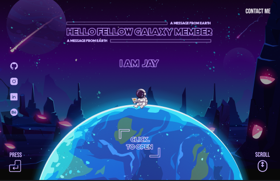
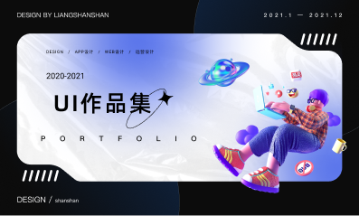

Primeiro Prompt de comando 
Rêferencias:
1. Ibrahim Memon - Portfolio Design Figma

**O que quis aproveitar**: Cores das imagens e animações.
- Cor de Fundo: #1A0B2E
- Cor de Texto: #F5F5F5
Animation - Texto aparecendo de pouco em pouco

Link Figma: https://www.figma.com/community/file/1182197835889504018/portfolio-design?after-auth-duplicate-file-id=1182197835889504018&fuid=1626739548853985726
Link Vercel: https://figma-portfolio-ten.vercel.app/

2. Background-img
JAYENDRA AWASTHI - Space Themed portfolio

**O que quis aproveitar**: Tema espacial para destacar a GS de Junho, E combinar com a cor de fundo escolhida. Usado no Quem sou eu.

Link Figma: https://www.figma.com/community/file/1192903581929005722/space-themed-portfolio?q_id=20623d6a-85c1-46e4-824e-499b5350f5c4

3. Informações-img
黎明 - figma设计封面图/作品集封面图
**O que quis aproveitar**:Estilização da página inicial. Combinar os estilos do Background-img e Informações-img juntando uma mistura de cores de roxo.

Link Figma: https://www.figma.com/community/file/1057236265627282925/figma-community?q_id=5feda8b2-cf43-43a1-a7c6-2479caf5dffb

4. Interative Particle Network 
LEON KOHLHAUßEN
**O que quis aproveitar**: Estilo de párticulas interativas combinando com tema do espaço.

Link Animation: https://leonkohli.dev/projects/particle-network

5. Dmitrii Kurilov Portfolio
**O que quis aproveitar**: Sistema do Portifolio com Três idiomas e baixar CV.
link: https://wantid.github.io/galaxy-portfolio/

6. Interative Blackhole
**O que quis aproveitar**: O buraco negro com clique do enter, puxando o as informações. 
link: https://codepen.io/StarKnightt/pen/VYvZeom

7. Timeline dos projetos e Pessoal.
**O que quis aproveitar** Timeline dos projetos e método de animação.

Link: https://new-webportfolio.vercel.app/